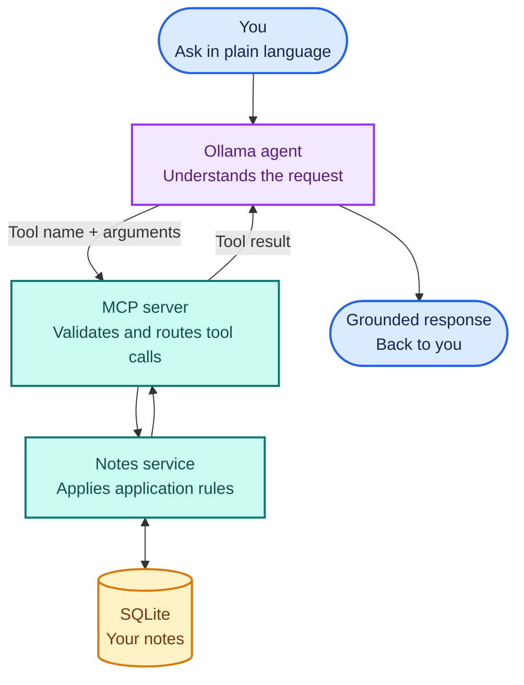

<div align="center">

# ModelForge

### Build AI systems, one concept at a time

ModelForge is a hands-on learning lab for understanding how modern AI systems
are designed, built, and connected. Start with the foundations, then grow into
topics such as retrieval-augmented generation (RAG), agents, and evaluation.
Learn each idea by building working systems—not by staying tied to one model,
framework, or tool.

</div>

---

## Start with a working system

The current project is a small notes assistant: a model interprets your
request and selects an action, application code performs it against stored
data, and the result returns for a grounded response. It provides a concrete
starting point for exploring the larger concepts and systems this lab will
cover.



This is the starting point, not the boundary. The learning path will expand
into RAG, agent design, evaluation, and other core AI engineering topics.

## Get started

To run the current example, you’ll need Python 3.12+ and
[`uv`](https://docs.astral.sh/uv/). [Ollama](https://ollama.com/) enables
natural-language chat; Node.js/npm is needed only for MCP Inspector.

```bash
uv sync
ollama pull llama3.2
uv run mcp dev src/modelforge/main.py
```

MCP Inspector lets you explore and call tools directly. To chat with the tools
through Ollama, start its service if needed and run:

```bash
uv run python -m modelforge.ollama_agent
```

## Explore

The current implementation is a notes assistant:

| 📝 Notes | ✨ Summaries | 🧰 MCP basics |
|---|---|---|
| Add, list, search, read, update, and delete notes | Retrieve this week’s notes or ask Ollama to summarize them | Try simple math and greeting tools |

Notes are stored in `data/notes.db` when you run commands from the project
root. Set `NOTES_DB_PATH` to choose another database. Generated summaries
send note contents to `OLLAMA_HOST` (local by default).

## Documentation

| Guide | What you’ll find |
|---|---|
| [Getting started](docs/GettingStarted.md) | Setup, MCP Inspector, configuration, troubleshooting, and learning path |
| [Architecture & concepts](docs/Architecture.md) | Request flow, tools, SQLite, and grounded summaries |
| [Implementation notes](src/modelforge/README.md) | Package responsibilities and development behavior |

## Development

```bash
uv run python -m unittest discover -s tests
uv build
```

> **Learning project:** ModelForge is not a production-ready notes service.
> The model selects tools; application code validates and performs operations.
