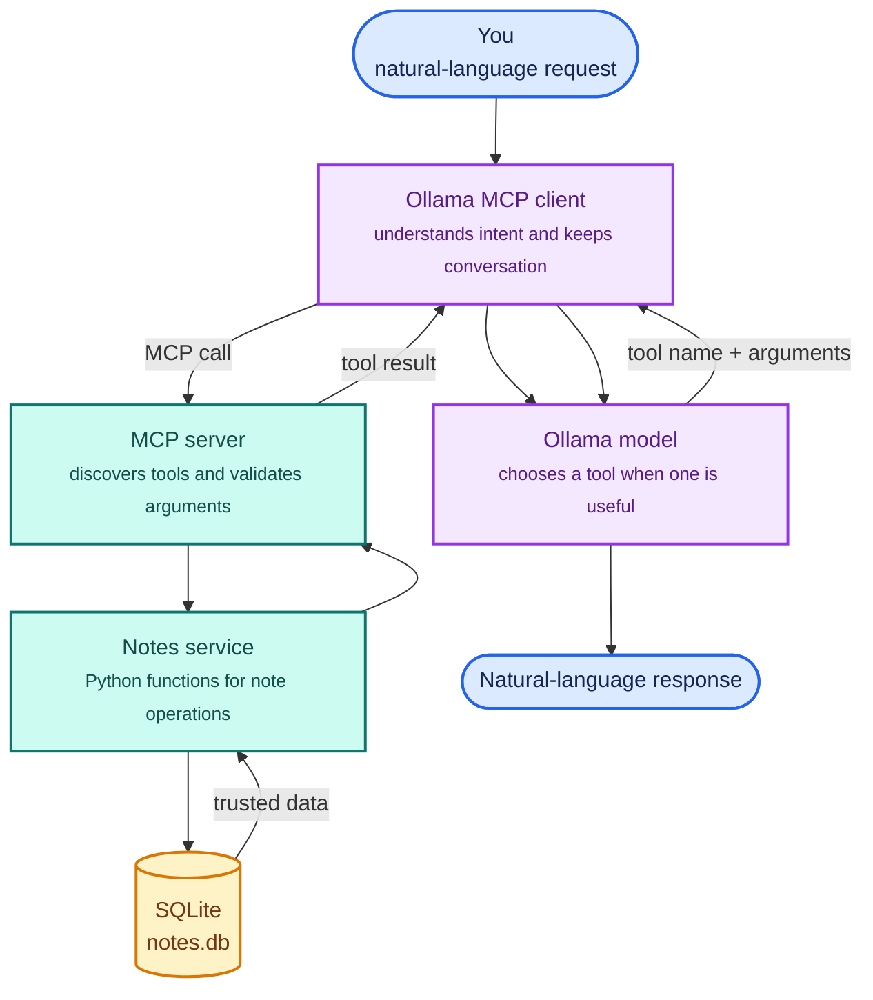
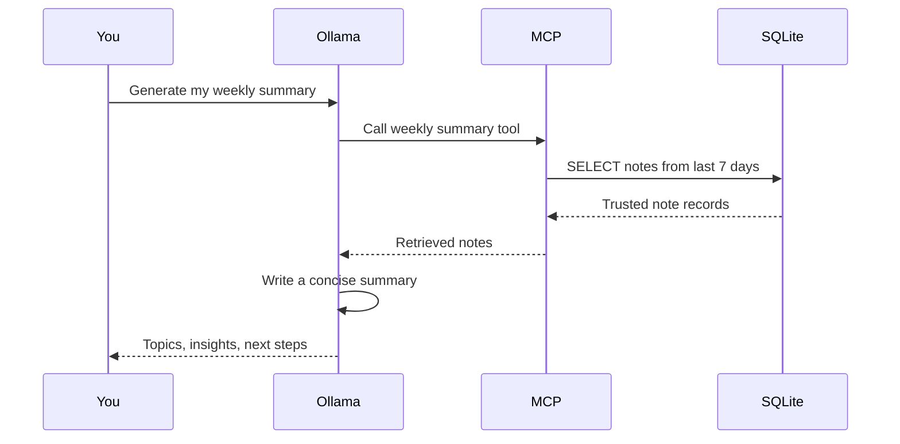
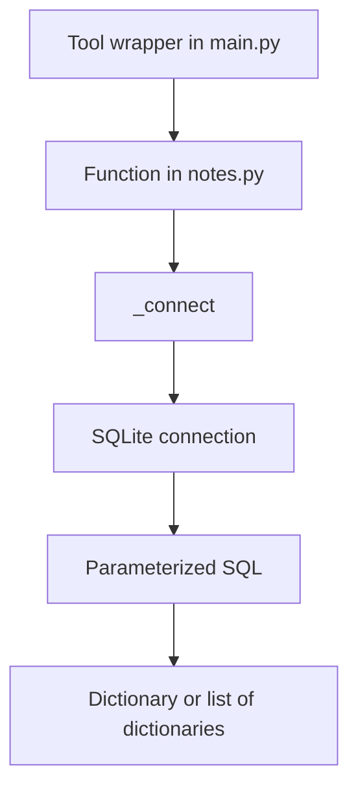
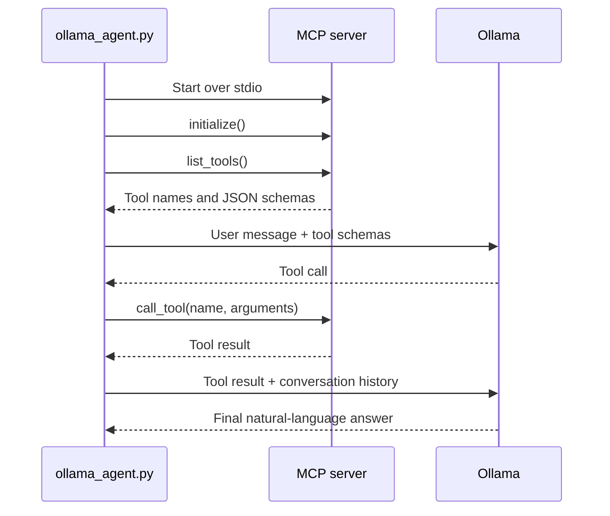

# ModelForge

### A hands-on AI systems learning lab

What if you could say:

> “Save a note about the project meeting, find my notes about deployment, and
> give me a summary of this week.”

This project builds that idea locally with **Python, SQLite, MCP, Ollama, and
MCP Inspector**. It starts as a tiny MCP server and grows into a personal
knowledge assistant that can understand natural language and safely operate on
your notes.

The important lesson is not just how to make an LLM answer questions. It is
how to connect an LLM to reliable application code.

## The story in one diagram



The model understands the request, but Python performs the real work. SQLite
stores the facts. MCP is the bridge between them. The arrows going back upward
are important: tool results return to the model so it can explain them.

The current server exposes:

| Tool | What it does |
|---|---|
| `add_note(title, content)` | Stores a note |
| `list_notes()` | Lists notes, newest first |
| `search_notes(query)` | Searches title and content by keywords |
| `read_note(note_id)` | Reads a note by ID |
| `read_note_by_title(title)` | Reads a note by exact title |
| `delete_note(note_id)` | Deletes a note |
| `weekly_learning_summary()` | Retrieves notes from the last seven days |
| `generate_weekly_learning_summary()` | Asks Ollama to summarize this week's notes |

The original learning tools remain available too:
`add_numbers`, `subtract_numbers`, `greet_user`, and `ask_ollama`.

## The core idea: retrieval first, generation second

An LLM should not be your source of truth. If you ask it what you learned last
week, it may invent an answer or rely on its conversation context.

Instead, this project uses a controlled flow:



This is the beginning of **RAG (Retrieval-Augmented Generation)**:

1. Retrieve relevant data from a trusted source.
2. Give that data to the model.
3. Generate an answer grounded in the retrieved data.

Today the retrieval is keyword and date based. Later, it can become semantic
search with embeddings.

## Project layout

```text
ModelForge/
├── src/
│   └── modelforge/
│       ├── __init__.py
│       ├── main.py           # MCP server and public tools
│       ├── notes.py          # SQLite persistence and queries
│       └── ollama_agent.py   # Ollama + MCP client
├── data/
│   └── notes.db          # Created automatically
├── pyproject.toml
├── uv.lock
└── README.md
```

Each file has one clear responsibility:

- **`main.py`** translates MCP requests into Python function calls.
- **`notes.py`** knows how notes are stored and queried.
- **`ollama_agent.py`** connects Ollama to the MCP server.
- **SQLite** persists notes after the process exits.

## Run it

### Requirements

- Python 3.12+
- `uv`
- Ollama
- An Ollama model, such as `llama3.2`
- Node.js/npm for MCP Inspector

Install the Python environment:

```bash
uv sync
```

Install a local model:

```bash
ollama pull llama3.2
ollama list
```

Ollama may already be running as a desktop service. If it is not:

```bash
ollama serve
```

If `ollama serve` says that port `11434` is already in use, Ollama is already
running. Verify it:

```bash
curl http://127.0.0.1:11434/api/tags
```

Always run commands from the project root:

```bash
cd /path/to/ModelForge
```

## First stop: MCP Inspector

Before involving an LLM, test the server directly:

```bash
uv run mcp dev src/modelforge/main.py
```

MCP Inspector lets you see the server's tools and invoke them manually. This
is the fastest way to understand MCP because there is no model guessing
involved.

Try this sequence:

1. Call `add_note`.
2. Use the returned ID with `read_note`.
3. Call `list_notes`.
4. Search for a word using `search_notes`.
5. Read the same note with `read_note_by_title`.
6. Call `weekly_learning_summary`.
7. Delete a test note.

For example, create a generic note:

```text
Title: Project meeting
Content: The team agreed to review the release checklist on Friday.
```

Inspector is the **MCP client**. `src/modelforge/main.py` is the **MCP server**.

## How the MCP server works

The server begins with:

```python
from mcp.server import MCPServer

mcp = MCPServer("ModelForge")
```

A normal Python function becomes an MCP tool through a decorator:

```python
@mcp.tool()
def add_note(title: str, content: str) -> dict:
    """Save a learning note with a title and content."""
    return add_note_record(title, content)
```

The decorator registers the function. Its name, docstring, parameters, and
type hints become the tool description that MCP clients discover.

The server starts with:

```python
if __name__ == "__main__":
    mcp.run()
```

When running over stdio, stdout is the MCP protocol channel. Avoid ordinary
debug prints there; use stderr or a logger instead.

## How SQLite stores the notes

`notes.py` creates the database automatically at:

```text
data/notes.db
```

The table is intentionally small:

```sql
CREATE TABLE IF NOT EXISTS notes (
    id INTEGER PRIMARY KEY AUTOINCREMENT,
    title TEXT NOT NULL,
    content TEXT NOT NULL,
    created_at TEXT NOT NULL
);
```

The data path can be changed without editing code:

```bash
NOTES_DB_PATH=$HOME/learning-notes.db uv run mcp dev src/modelforge/main.py
```

The database layer follows a simple pattern:



For example, `add_note()`:

1. Trims the title and content.
2. Rejects empty values.
3. Opens SQLite.
4. Executes a parameterized `INSERT`.
5. Reads the inserted row back.
6. Returns a dictionary containing the ID, title, content, and timestamp.

Parameterized SQL keeps values separate from the query:

```python
connection.execute(
    "INSERT INTO notes (title, content, created_at) VALUES (?, ?, ?)",
    (title, content, created_at),
)
```

This is safer than concatenating user input into SQL.

`search_notes()` splits a query into keywords and requires every keyword to
appear in either the title or content. It is useful and easy to understand,
but it is not semantic search: “functions that wrap other functions” and
“decorators” are not automatically recognized as equivalent.

## How Ollama uses MCP tools

Run the natural-language client:

```bash
uv run python -m modelforge.ollama_agent
```

Then try:

```text
You: Save a note titled Grocery list with milk, rice, and vegetables.
Assistant: I saved your note...

You: Show my notes about groceries.
Assistant: I found...

You: Read the note titled Grocery list.
Assistant: ...

You: Generate my weekly learning summary.
Assistant: ...
```

Exit with `exit` or `quit`.

The client performs this loop:



The model does not directly open SQLite. It selects a tool; the MCP client
executes it; Python validates and performs the operation.

The interactive client keeps the current conversation in a `messages` list:

- system instructions
- user messages
- assistant messages
- tool results

That is why follow-up requests can refer to an earlier answer. The history is
in memory and disappears when the process exits.

Small local models can occasionally print a JSON-looking tool call instead of
using Ollama's structured `tool_calls` field. The client includes a fallback
parser and a system instruction saying:

- use `read_note_by_title` for titles
- use `read_note` for numeric IDs
- never show tool-call JSON to the user

## The AI weekly summary

There are two summary tools:

### Deterministic summary

```text
weekly_learning_summary()
```

This retrieves recent notes and returns their titles and contents. It does not
ask an LLM to interpret them.

### Generated summary

```text
generate_weekly_learning_summary()
```

This first retrieves the notes, then sends them to Ollama with instructions to
produce:

- Topics learned
- Key insights
- Suggested next steps

The prompt also tells Ollama not to invent information that is absent from the
notes. This separation is important:

```text
SQLite answers: “What notes exist?”
Ollama answers: “How can I explain these notes naturally?”
```

## Useful configuration

| Variable | Default | Purpose |
|---|---|---|
| `OLLAMA_HOST` | `http://127.0.0.1:11434` | Ollama API address |
| `OLLAMA_MODEL` | `llama3.2` | Local model |
| `OLLAMA_TIMEOUT` | `120` | Request timeout in seconds |
| `NOTES_DB_PATH` | `data/notes.db` | SQLite file location |

Example:

```bash
OLLAMA_MODEL=llama3:latest \
OLLAMA_TIMEOUT=180 \
NOTES_DB_PATH=$HOME/learning-notes.db \
uv run python -m modelforge.ollama_agent
```

## A small hands-on learning path

Do not try to understand the whole project at once. Follow one request:

```text
“Read the note titled Project meeting”
```

Trace it like this:

1. Ollama identifies the intention and chooses `read_note_by_title`.
2. `ollama_agent.py` receives the tool call.
3. The MCP client sends `read_note_by_title` to `main.py`.
4. The wrapper calls `get_note_by_title()` in `notes.py`.
5. SQLite executes a `SELECT`.
6. The result travels back through MCP.
7. Ollama turns the dictionary into a human answer.

Then experiment:

### Exercise 1: add a tool

Add `count_notes()` to `notes.py` and expose it in `main.py`.

### Exercise 2: improve the data model

Add `updated_at` or a `category` column. Update the `INSERT` and `SELECT`
queries and observe the tool schema in Inspector.

### Exercise 3: add update support

Implement `update_note(note_id, title, content)`. Test the database function
directly, then expose it as an MCP tool.

### Exercise 4: compare retrieval and generation

Ask Inspector for `weekly_learning_summary()`, then ask the Ollama agent for
`generate_weekly_learning_summary()`. Compare the raw facts with the generated
explanation.

### Exercise 5: add semantic search

Once keyword search is clear, generate embeddings for notes and retrieve by
meaning. That is a natural next step toward a fuller RAG system.

## Troubleshooting

### The script cannot be found

Run from the repository root:

```bash
pwd
ls src/modelforge/ollama_agent.py
uv run python -m modelforge.ollama_agent
```

### Ollama is already running

`ollama serve` returning “address already in use” is usually good news. Check:

```bash
curl http://127.0.0.1:11434/api/tags
```

### Ollama connection refused

Check the model service and the configured address:

```bash
echo "$OLLAMA_HOST"
ollama list
curl http://127.0.0.1:11434/api/tags
```

Use the explicit address if necessary:

```bash
OLLAMA_HOST=http://127.0.0.1:11434 \
uv run python -m modelforge.ollama_agent
```

### Inspector sees different notes

Both processes must use the same database. Check:

```bash
echo "$NOTES_DB_PATH"
ls -l data/notes.db
```

### Ollama chooses the wrong tool

Use precise language while learning:

```text
Read the note with ID 2.
Read the note with the exact title Project meeting.
Search notes for deployment and release.
```

Test the same operation in Inspector. If Inspector works, the database and MCP
server are probably correct; the remaining issue is model tool selection.

## Commands you will use most

```bash
# Install dependencies
uv sync

# Test MCP tools in the browser
uv run mcp dev src/modelforge/main.py

# Start natural-language chat
uv run python -m modelforge.ollama_agent

# Ask one question
uv run python -m modelforge.ollama_agent "Search my notes for deployment"

# Check Python syntax
uv run python -m py_compile src/modelforge/main.py src/modelforge/notes.py src/modelforge/ollama_agent.py

# Check installed Ollama models
ollama list
```

## Where to go next

The current project teaches the foundation:

```text
Python functions
    → MCP tools
    → SQLite persistence
    → Ollama tool calling
    → Retrieval-grounded generation
```

The next improvements can build on that foundation:

1. Automated tests for every notes operation.
2. `update_note()` and confirmation before deletion.
3. Categories, tags, and date-range filters.
4. MCP resources and prompts.
5. Semantic search with embeddings.
6. Better citations and note references in generated answers.

The most important mental model is simple:

> The model decides what would help. Your Python application decides what is
> allowed and executes it. The database remembers the facts.

That is the difference between a chatbot that merely talks and an assistant
that can reliably work with your knowledge.
