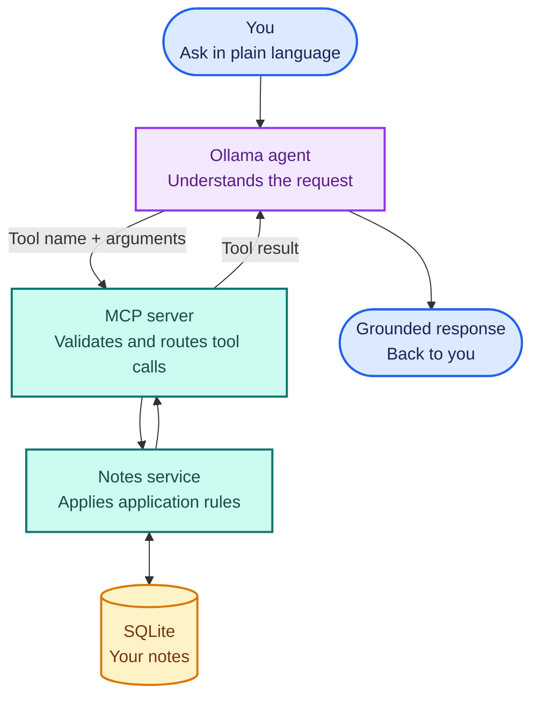

# MCP Notes Assistant

This project demonstrates MCP tools, a read-only notes resource, a reusable
prompt, SQLite persistence, and an Ollama client. For the broader learning
repository, see the [ModelForge overview](../../README.md). For setup and
hands-on usage, start with the [getting-started guide](./docs/GettingStarted.md).



## Module responsibilities

| Module | Responsibility |
|---|---|
| [`main.py`](./src/modelforge/main.py) | Defines MCP tools, a notes resource, and a learning-review prompt; delegates note operations and calls the Ollama generate API |
| [`notes.py`](./src/modelforge/notes.py) | Opens and migrates SQLite storage; implements note queries |
| [`ollama_agent.py`](./src/modelforge/ollama_agent.py) | Starts the MCP server as a child process and runs the Ollama tool-call loop |
| [`__init__.py`](./src/modelforge/__init__.py) | Provides the installed `modelforge` server command |

Keep the layers separate: tool wrappers should translate MCP inputs and errors,
while persistence rules belong in `notes.py`. The Ollama client selects and
calls tools; it should not access the database directly.

## Notes persistence

- The default database is `data/notes.db` relative to the process working
  directory. Set `NOTES_DB_PATH` when launching from another directory or when
  sharing an existing database between processes.
- The schema is initialized on connection. Existing databases that predate
  `updated_at` are migrated in place, preserving their notes.
- Connections are scoped to each operation and closed after use.
- SQL values are parameterized. Search keywords escape SQLite `LIKE`
  wildcards, so `%` and `_` are searched literally.
- Timestamps are UTC ISO-formatted strings. Updates change `updated_at` without
  changing `created_at`.

The application does not automatically move databases. If an earlier run
created `src/data/notes.db`, explicitly select it with
`NOTES_DB_PATH=src/data/notes.db` to continue using those notes.

## MCP tool behavior

`main.py` maps expected note validation and lookup failures to MCP `ToolError`s
so clients receive a useful tool result instead of an unexpected server
exception. Storage failures and other programming errors are not hidden.

The Ollama conversational client asks the user to type `yes` before invoking
`delete_note`; any other response or unavailable confirmation input cancels
the deletion. MCP clients such as Inspector have their own interaction model
and should confirm destructive actions before invoking the tool.

The server also exposes the read-only `notes://modelforge/notes` JSON resource
so clients can read the current notes as context without invoking a tool.

The `review_learning_topic` MCP prompt accepts a topic and returns a prepared
message that refers clients to the notes resource for relevant context.

## Ollama client behavior

`ollama_agent.py` obtains tool schemas from the running MCP server and passes
them to Ollama. It supports the structured `tool_calls` response and a
best-effort JSON-text fallback for small models. Tool rounds are capped at
five per request.

Conversation history is in memory only. A failed request does not commit its
partial turn to the caller's history. `OLLAMA_TIMEOUT` must be a positive
number; `OLLAMA_HOST`, `OLLAMA_MODEL`, and `OLLAMA_TIMEOUT` configure the
service.

## Development checks

Run these commands from the repository root:

```bash
uv run --package modelforge python -m unittest discover -s projects/mcp-notes-assistant/tests
uv run --package modelforge python -m py_compile projects/mcp-notes-assistant/src/modelforge/*.py
uv build --package modelforge
```

The tests use temporary databases and mocked Ollama interactions; they do not
require a live Ollama service. For setup, interactive usage, examples, and
troubleshooting, see the [getting-started guide](./docs/GettingStarted.md)
and [architecture guide](./docs/Architecture.md).
