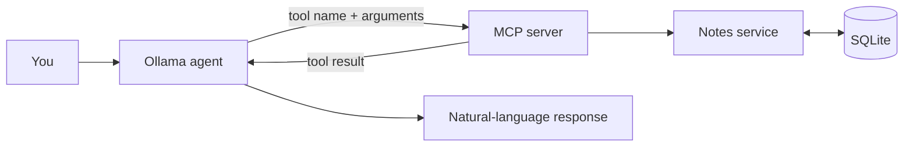
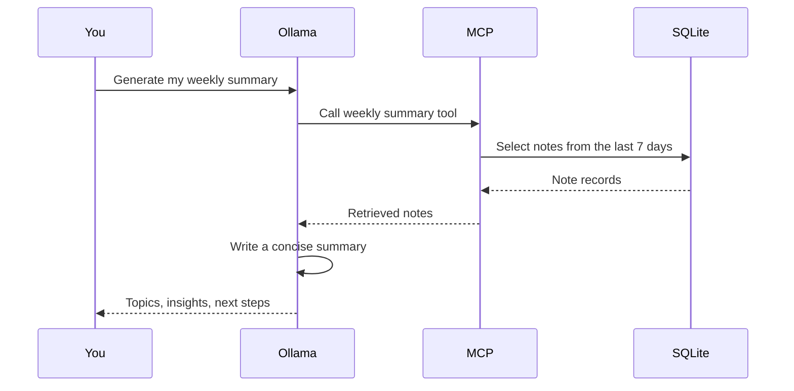

# Architecture and concepts

ModelForge connects natural-language requests to application code that can
validate and perform real operations. The model selects a tool; Python and
SQLite remain responsible for the data.

## Request flow



For a generated weekly summary, the client asks the MCP server to retrieve
recent notes, then sends their contents to Ollama to produce a summary:



This is a simple retrieval-augmented generation (RAG) pattern: retrieve
trusted data, provide it to a model, and generate an answer grounded in that
data. Retrieval is currently keyword- and date-based, not semantic.
For a step-by-step explanation of the broader RAG pipeline and the planned
ModelForge learning path, see the
[RAG tutorial](../../../docs/concepts/rag/RAG-Tutorial.md).

## MCP tools

The notes tools exposed by the server are:

| Tool | Purpose |
|---|---|
| `add_note(title, content)` | Store a note |
| `list_notes()` | List notes, newest first |
| `search_notes(query)` | Search title and content by every query keyword |
| `read_note(note_id)` | Read a note by numeric ID |
| `read_note_by_title(title)` | Read one note by exact title, ignoring case |
| `update_note(note_id, title, content)` | Update a note |
| `delete_note(note_id)` | Delete a note |
| `weekly_learning_summary()` | Retrieve notes created in the last seven days |
| `generate_weekly_learning_summary()` | Ask Ollama to summarize recent notes |

The `@mcp.tool()` decorator registers a Python function; its name, docstring,
parameters, and type hints are exposed to clients. MCP validates tool
arguments before the function runs. Expected note validation and lookup
failures are returned as tool errors; unexpected storage or programming
failures are not silently hidden.

## MCP resources

The server exposes `notes://modelforge/notes` as an `application/json`
resource containing all saved notes, newest first. Clients can discover it
with resource listing and read it to get context. Unlike a tool such as
`search_notes`, reading this resource does not perform an action or accept
arguments; it provides a snapshot of the notes at read time.

## MCP prompts

The server provides a `review_learning_topic(topic)` prompt. A user selects
it and supplies a topic; MCP returns a prepared message asking the AI to
review that topic using the notes resource when available. Prompts are
reusable, user-invoked message templates—not tools that execute application
actions. The client can choose to send the returned message to an AI.

## SQLite notes

The database is created on first use. Its table is intentionally small:

```sql
CREATE TABLE IF NOT EXISTS notes (
    id INTEGER PRIMARY KEY AUTOINCREMENT,
    title TEXT NOT NULL,
    content TEXT NOT NULL,
    created_at TEXT NOT NULL,
    updated_at TEXT
);
```

The default path is `data/notes.db` relative to the process working directory.
Set `NOTES_DB_PATH` to select another database. Existing databases missing
`updated_at` are migrated in place, preserving their records. Timestamps are
UTC ISO-formatted strings; updating a note preserves `created_at`.

Values are passed to SQLite with parameterized queries. Search keywords escape
`LIKE` wildcard characters, so `%` and `_` are searched literally. A keyword
search is not semantic retrieval: “decorators” will not automatically match
“functions that wrap other functions.”

Each database operation uses and closes its own connection. Processes share
notes only when configured to use the same database file. The application
doesn't automatically move old databases.

## Ollama and conversation handling

The agent starts the MCP server as a child process over stdio, discovers its
tool schemas, and passes those schemas to the Ollama chat API. It then
executes requested tools through MCP and returns their results to the model.
The model never opens SQLite directly.

The client supports Ollama's structured `tool_calls` response and a
best-effort JSON-text fallback for small models. It allows up to five tool
rounds for one request. Conversation history remains in memory and is lost
when the client exits. Failed requests do not add a partial turn to the
history.

Ollama runs locally by default. If `OLLAMA_HOST` points to a remote server,
prompts and note contents sent for generation go to that server.

For implementation details, see the
[MCP project README](../README.md). For hands-on steps, see the
[getting-started guide](./GettingStarted.md#learning-path).
