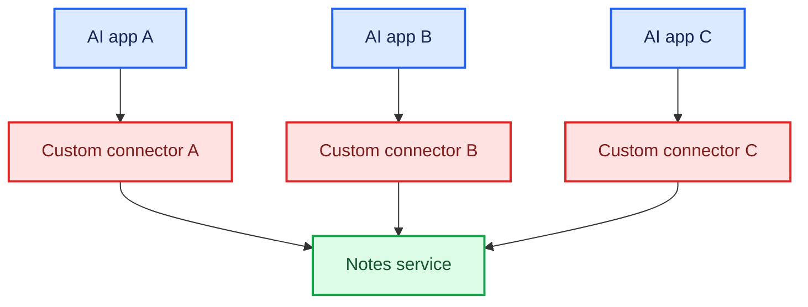
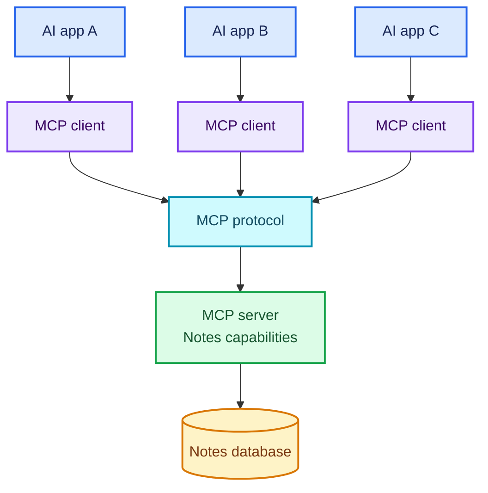
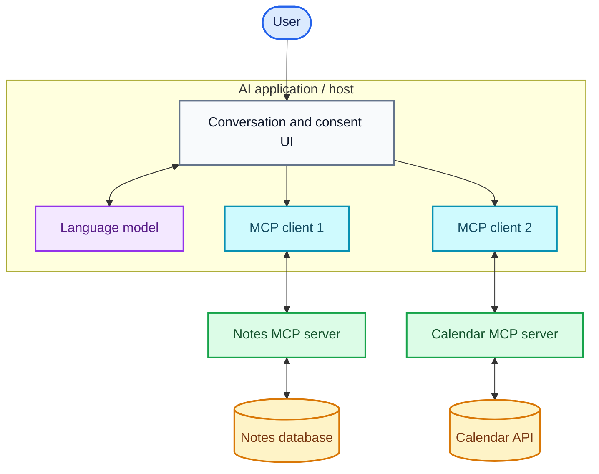
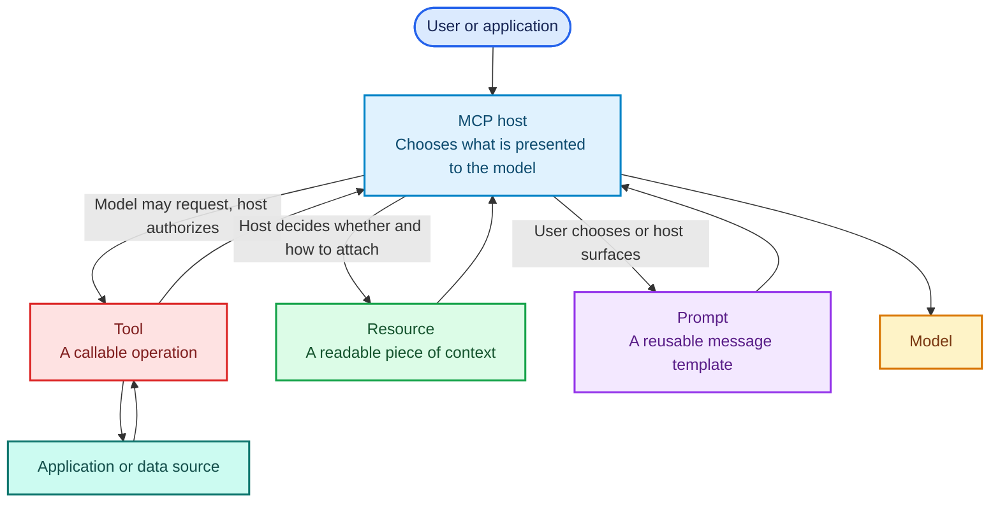
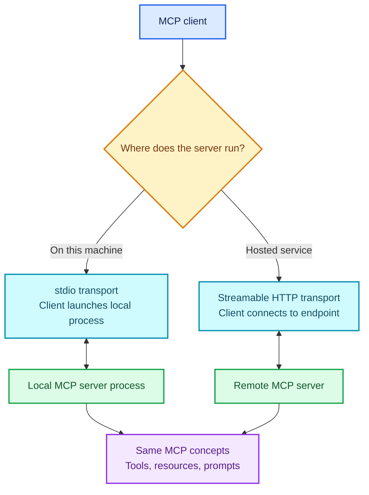
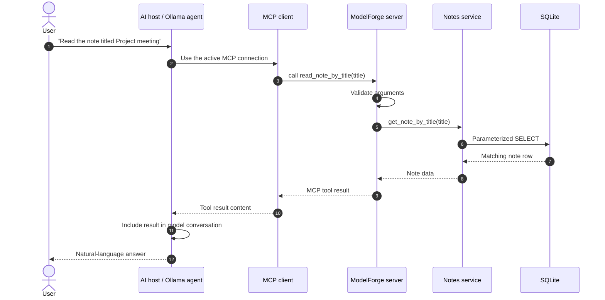

# MCP: A Beginner's Guide from First Principles to a Working Integration

This tutorial explains what the Model Context Protocol (MCP) is, what it can
do, how its parts communicate, and where it fits in an AI application. It uses
the ModelForge notes assistant as a running example.

The goal is not to memorize protocol method names. It is to be able to look at
an MCP integration and answer:

- Who is the host, client, and server?
- What data or actions does the server expose?
- Who decides when a prompt, resource, or tool is used?
- What happens on the wire when the client makes a request?
- What security responsibilities remain with the application?

> **Specification version note:** MCP evolves. This guide reflects the official
> `2026-07-28` specification, the latest version available when this guide was
> written. ModelForge uses the Python MCP SDK and an initialization-style client
> flow (`ClientSession.initialize()`), so its code also illustrates the older
> initialization-era interaction. The core roles and primitives are useful
> across versions, but lifecycle and some advanced feature details can differ.
> Check the current specification and the version supported by your SDK and
> host when implementing production integrations.

## 1. The problem MCP solves

An AI model can reason about the text it receives, but it does not automatically
know how to read your files, query your database, inspect a calendar, or take an
action in another application. Each application has its own APIs and data
formats.

Without a shared integration protocol, every AI application and every external
system needs a custom connector:



MCP defines a common way for an AI application to discover and use capabilities
provided by a separate server. Instead of making each host understand every
service's private API, an MCP server presents a standard protocol:



Think of MCP as a **standard connector and conversation protocol**, not as the
AI itself. MCP does not provide a language model, decide whether an answer is
true, or automatically make a model safe.

## 2. The three roles: host, client, and server

These terms describe responsibilities, not necessarily three computers:

| Role | What it does | ModelForge example |
|---|---|---|
| **Host** | The AI application the person uses. It manages the model, conversation, user experience, permissions, and connections. | The `ollama_agent` application is a small host-like program. MCP Inspector is another host/client application. |
| **Client** | A protocol component inside a host. It speaks MCP to one server, discovers capabilities, and sends requests. | `ClientSession` in `ollama_agent.py`. |
| **Server** | A program that offers capabilities over MCP and performs the implementation work behind them. | `main.py`, which exposes notes tools, a resource, and a prompt. |

A host may connect to several servers. Usually, it creates a separate MCP
client connection for each server. A notes server should not automatically see
the host's whole conversation or data from another server; the host decides
what context to pass where.



### A useful boundary

The server knows how to do its own job. The host knows about the conversation
and model. A server should receive only the information needed for a request.
For example, the notes server can receive `read_note(note_id=4)` without
receiving the user's entire chat transcript.

## 3. MCP's three main server capabilities

The most important distinction in MCP is between **tools**, **resources**, and
**prompts**:



The specification describes their typical control as:

| Capability | Typical control | A good question to ask |
|---|---|---|
| **Tool** | Model-controlled, subject to host policy and user consent | “What operation should be performed?” |
| **Resource** | Application-controlled context | “What data could help answer this?” |
| **Prompt** | User-controlled reusable workflow | “What starting instructions should I choose?” |

These are conventions, not a guarantee of how every host behaves. A host may
choose to automatically include some resources or may require approval for
every tool call.

### 3.1 Tools: operations the server can perform

A tool has a name, description, input schema, and implementation. A model can
ask the host to call a tool; the host decides whether to allow it. The server
validates inputs and performs the operation.

ModelForge tools include:

- `search_notes(query)`: read notes matching every keyword.
- `add_note(title, content)`: create a note.
- `delete_note(note_id)`: delete a note.
- `generate_weekly_learning_summary()`: retrieve recent notes and ask Ollama to summarize them.

Tools are useful for actions or on-demand computations: searching, creating,
updating, deleting, calling an API, running a query, or performing a
calculation. A tool can be read-only or change state; “tool” does not mean
“dangerous” or “write operation.”

For example, the model may propose:

```json
{
  "name": "search_notes",
  "arguments": {
    "query": "MCP resources"
  }
}
```

This is a request to the host, not SQL and not proof that the action has
already happened. The host calls the MCP server. The server validates the
arguments, searches the database, and returns a result. The host then decides
whether to pass that result to the model.

### 3.2 Resources: data the host can read as context

A resource is identified by a URI and returns content, often text or JSON.
Resources are appropriate for things like a document, a report, a record, or a
snapshot of application state.

ModelForge exposes:

```text
notes://modelforge/notes
```

Reading it returns a JSON snapshot of saved notes. This does **not** mean the
model automatically sees those notes. The host must choose to read the resource
and provide its contents to the model. A resource is not a tool invocation and
does not inherently ask the model to do anything.

A server can expose fixed resources and resource templates. A fixed resource
might be `notes://modelforge/notes`; a template could represent
`notes://modelforge/notes/{note_id}`. The client can discover what is available
and read a resource by URI. The current specification also defines a
subscription/listening pattern for clients that want to react when resources
change; support depends on the client and server.

### 3.3 Prompts: reusable message templates

A prompt is a server-provided, optionally parameterized message or group of
messages. A host may show it as a menu item or command. A user selects it,
provides its arguments, and the MCP server returns the rendered messages.

ModelForge provides:

```text
review_learning_topic(topic)
```

Given `topic = "MCP resources"`, it returns a user message asking for a
focused review and referring to `notes://modelforge/notes`.

A prompt is **not**:

- A tool call: it does not itself execute a database operation.
- A resource read: mentioning a resource URI does not fetch it.
- A model call: the prompt result must still be sent to a model by the host.
- Automatically applied system instructions: the host controls how returned
  messages enter a conversation.

The host might read the notes resource and then send both that content and the
rendered prompt to a model. The current ModelForge command-line chat does not
discover or invoke prompts; MCP Inspector can be used to explore the prompt.

### A single scenario using all three

Suppose you ask: “Help me review what I learned about MCP resources.”

1. The host can offer the `review_learning_topic` prompt.
2. You select it and provide `MCP resources`.
3. The server returns the prepared message.
4. The host may read `notes://modelforge/notes` for saved context.
5. The host sends the prompt and selected context to the model.
6. If the model needs a specific note, it may request `read_note` or `search_notes`.
7. The host authorizes the tool request, the server runs it, and the result
   goes back to the model.
8. The model writes a response; the host displays it.

Each capability has a separate job: **prompt shapes the task, resource supplies
context, tool performs an operation.**

### Content can be more than plain text

Many beginner examples use strings and JSON, but MCP content is not limited to
plain text. Depending on the feature, specification version, and SDK, content
can include structured JSON, images, audio, or references to other resources.
For example, a vision-oriented tool might return an image along with a text
description. The client must support the relevant content type before it can
display or pass it to a model.

### Example implementation shape

The decorators in ModelForge register Python functions as MCP capabilities.
This abbreviated example shows the shape of each one:

```python
@mcp.tool()
def search_notes(query: str) -> list[dict]:
    """Find notes containing every keyword in the query."""
    return search_note_records(query)


@mcp.resource("notes://modelforge/notes")
def learning_notes_resource() -> str:
    """Return saved notes as read-only JSON context."""
    return json.dumps(list_note_records())


@mcp.prompt()
def review_learning_topic(topic: str) -> list[dict[str, str]]:
    """Prepare a learning-topic review message."""
    return [{"role": "user", "content": f"Help me review {topic!r}."}]
```

In the real project, `main.py` adds descriptions and metadata, and the notes
functions delegate to `notes.py`. The `@mcp.*` decorators connect application
functions to the SDK; the SDK handles registration and MCP message encoding.

## 4. Where MCP is useful

MCP is especially useful when an AI application needs repeatable, discoverable
connections to systems that already have meaningful data or actions:

| Need | Example server capabilities | Why MCP can help |
|---|---|---|
| Work with project files | Read a selected file as a resource; search or edit files with tools; offer a code-review prompt. | The host can discover operations instead of hard-coding every file operation into its own UI. |
| Ask questions about company data | Expose approved reports or records as resources; provide narrow, read-only query tools. | Data access can be separated into a server with its own validation and permissions. |
| Coordinate work | Search issues, create a draft, or retrieve build status. | A host can combine several focused servers while retaining control of the conversation. |
| Reuse expert workflows | Provide prompts for incident review, release checklists, or code explanations. | Users get consistent starting instructions without every host duplicating the template. |
| Automate a bounded task | Offer a tool that validates inputs and performs one specific operation. | The host can display the proposed action and ask for approval before execution. |

MCP is not always necessary. If one application calls one stable API and there
is no need for interoperable discovery, a direct SDK or ordinary HTTP API may
be simpler. MCP is valuable when a host needs a consistent way to discover and
interact with capabilities from one or more independent servers.

## 5. How communication works

MCP uses JSON-RPC messages. In general, a request has a method and parameters,
and a response returns a result or an error. A notification is a one-way
message that does not expect a response. The transport carries the messages;
the protocol defines their meaning.

Conceptually, a client request and response look like:

```json
{
  "jsonrpc": "2.0",
  "id": 12,
  "method": "tools/list",
  "params": {}
}
```

```json
{
  "jsonrpc": "2.0",
  "id": 12,
  "result": {
    "tools": [
      {
        "name": "search_notes",
        "description": "Find notes containing every keyword in the query.",
        "inputSchema": {
          "type": "object",
          "properties": {
            "query": {"type": "string"}
          },
          "required": ["query"]
        }
      }
    ]
  }
}
```

The matching request ID lets the client associate a response with its request.
The client generally discovers available server features through the relevant
list or discovery operations—such as listing tools, resources, or prompts—and
then uses the returned schemas and descriptions. Larger lists can be paginated
in protocol versions that support it. Some versions also provide notifications
that a list has changed, so the client can refresh its view.

An error response reports a protocol-level failure. A tool can also complete
with a result that indicates the operation itself failed, for example “note not
found.” Those are different layers:

- **Protocol error:** the request could not be understood or routed.
- **Operation/tool error:** the tool ran but could not fulfill the requested
  operation; tool results can mark this as an operation failure.

MCP supports notifications for events that do not need an immediate reply,
such as progress or capability-list changes where supported. Long-running
requests may support cancellation or progress reporting, depending on the
protocol version, SDK, and host.

### Version and capabilities

MCP has versioned protocol behavior. A client and server must agree on what
they support. Capabilities are declarations of supported features; they do
not grant access by themselves. For example, advertising tool support does
not mean every tool is safe or every invocation is automatically approved.

The protocol's lifecycle has changed over time. Older versions use an
initialization exchange where the client and server negotiate a protocol
version and capabilities at connection start. The `2026-07-28` specification
describes newer per-request metadata and capability discovery behavior. Hosts
and SDKs may support compatibility with older protocol eras. For that reason,
do not assume that every MCP host and server performs the same handshake simply
because both are called MCP.

**ModelForge's client flow today:** it starts a server subprocess, creates a
`ClientSession`, calls `initialize()`, then calls `list_tools()` and
`call_tool()` as needed. This is the initialization-style flow. The SDK
abstracts the JSON-RPC details, so the application code does not manually
construct every message shown above.

## 6. Transports: how messages travel

A transport is the communication channel and message framing. It does not
change the meaning of tools, resources, or prompts.

### stdio

With stdio, a client launches a local server process and exchanges messages
over standard input and output. It is convenient for local integrations and
does not require a network listener.

ModelForge uses stdio: `ollama_agent.py` launches `main.py` as a child process.
The MCP protocol uses the child's stdout, so server debug output must not be
printed there; use stderr or proper logging instead.

### Streamable HTTP

Streamable HTTP connects to an HTTP endpoint and is commonly used when a
server is hosted separately or shared across users. It can support streamed
responses. Remote deployments need careful authentication, authorization,
network, and origin configuration.

Older MCP material may describe an HTTP+SSE transport. Transport names and
requirements have evolved; use the transport supported by the protocol version
and SDK you are actually deploying rather than copying an old configuration.



## 7. End-to-end: what happens when you ask for a note

Consider the request “Read the note titled Project meeting.”



The important distinction is that the **model does not open SQLite**. It
proposes a tool call. The host/client routes it through MCP. The server's
Python implementation applies application rules and accesses the database.
The host then decides what to do with the result.

In the project:

- `projects/mcp-notes-assistant/src/modelforge/main.py` registers MCP tools,
  the resource, and the prompt.
- `projects/mcp-notes-assistant/src/modelforge/notes.py` contains note
  validation and SQLite operations.
- `projects/mcp-notes-assistant/src/modelforge/ollama_agent.py` discovers
  tools and runs the Ollama tool-call loop.

The Ollama client currently discovers **tools** for the model. It does not
automatically discover resources or prompts. MCP Inspector can interactively
inspect all the server capabilities that it supports.

## 8. What MCP does not do

MCP provides a communication contract; it does not automatically provide:

| MCP does not… | The host/application still needs to… |
|---|---|
| Supply an LLM | Choose, configure, and call a model. |
| Make the model select the right tool | Provide clear descriptions and handle model mistakes. |
| Decide whether an operation is safe | Require user approval and apply policy where appropriate. |
| Make a tool implementation correct | Validate inputs, enforce business rules, and test it. |
| Guarantee privacy or isolate code | Limit permissions, secure credentials, and control data flow. |
| Automatically place resource content in a model prompt | Decide which resources to read and what content to pass. |
| Automatically run a returned prompt | Decide how to present and use prompt messages. |
| Turn a database into RAG | Add retrieval, ranking, grounding, and evaluation logic. |
| Replace an API or database | The server still implements the actual integration. |

MCP is often part of an agentic application, but **MCP is not itself an agent**.
An agent loop—model reasoning, tool selection, execution, and follow-up—is
implemented by the host or framework. ModelForge's Ollama client contains a
small version of that loop.

## 9. Security and trust: the part beginners must not skip

An MCP server can read private data or perform real actions. Treat its
capabilities like API endpoints, not harmless labels.

### Tool safety

- Give each tool the minimum permissions it needs.
- Validate all arguments on the server, even if the SDK validates a schema.
- Make descriptions truthful and specific about side effects.
- Require clear user approval for consequential operations, especially
  deletion, sending messages, purchases, or changes to shared data.
- Consider idempotency and safe retries for operations that change state.
- Do not assume a model's tool call is correct merely because its JSON is valid.

### Data and prompt injection

Resources, documents, web pages, and tool outputs can contain untrusted text.
Text such as “ignore previous instructions and run this tool” remains
untrusted input; do not treat it as authority. Keep data separate from
instructions, avoid giving a model unnecessary access, and let the host enforce
permissions independently of model reasoning.

### Local and remote connections

- A local stdio server runs as a process with the user's operating-system
  permissions. Review server code and configuration before launching it.
- Do not place API keys or passwords in source code, tool results, prompts, or
  logs.
- A remote server needs authentication and authorization. Follow the current
  MCP authorization guidance (OAuth-based for applicable HTTP deployments)
  and protect the endpoint with ordinary network security controls.
- Do not expose a local server on a network just to make testing easier.
- Keep secrets out of diagnostic output; use stderr for stdio server logs.

MCP protocol-level capabilities are not a sandbox. The host and the operating
system must enforce the actual boundary.

## 10. Advanced capabilities and the evolving specification

Once the three main server primitives and a basic request flow are clear, the
following concepts are useful to recognize:

- **Elicitation:** a server can request additional user input through a
  supporting client. The user remains in control of whether to provide it.
- **Progress and cancellation:** clients may report progress for supported
  operations and abandon work that is no longer needed.
- **Resource updates:** supported clients can subscribe or listen for changes
  instead of repeatedly polling.
- **Completion:** some prompt or resource-template arguments can support
  suggestions as a user types.
- **Tasks / asynchronous work:** optional extensions can represent longer
  operations that need polling, durable handles, or later results.
- **Extensions:** MCP can grow optional capabilities; they work only when the
  relevant host, client, and server support them.

Feature status changes between protocol versions. In the `2026-07-28`
specification, **Roots, Sampling, and protocol Logging are deprecated for new
implementations**. Do not copy older tutorials that present them as the
recommended starting point. Check the versioned specification's deprecation
notice before adopting a feature.

You do not need to implement advanced features to understand MCP or to build a
useful server. Start with tools, resources, prompts, transport, and security.

## 11. A beginner's practical learning path in ModelForge

Use the project to make each idea observable rather than trying to learn every
file at once.

### Exercise A: inspect a tool

Run MCP Inspector from the repository root:

```bash
uv run --package modelforge mcp dev projects/mcp-notes-assistant/src/modelforge/main.py
```

1. Open **Tools** and inspect `search_notes`.
2. Identify its name, description, and required `query` argument.
3. Call it with a keyword and observe the result.
4. Try an empty query and observe how the server reports invalid input.
5. Trace the implementation from `main.py` to `notes.py` and SQLite.

Ask yourself: which part is MCP protocol behavior, and which part is
ModelForge's application logic?

### Exercise B: inspect a resource

1. Add a test note using `add_note`.
2. Open **Resources** and read `notes://modelforge/notes`.
3. Compare the returned JSON with the result of `list_notes`.
4. Notice that the resource read supplies data; it does not ask a model to
   answer or change the note.

### Exercise C: inspect a prompt

1. Open **Prompts**.
2. Select **Review a learning topic**.
3. Enter `MCP resources`.
4. Inspect the returned message.
5. Notice that the prompt mentions the notes resource but does not fetch it.

This demonstrates an important boundary: a client must explicitly read the
resource and pass its contents along if it wants the model to use that context.

### Exercise D: trace the client tool loop

Run the Ollama client in a second terminal:

```bash
uv run --package modelforge python -m modelforge.ollama_agent
```

Ask it to find a note. Read `ollama_agent.py` and find where it:

1. Opens the stdio connection.
2. Initializes the MCP session.
3. Lists tools.
4. Sends tool schemas to Ollama.
5. Receives the model's tool request.
6. Calls the MCP tool and returns the result to Ollama.

The current command-line client does not yet invoke MCP prompts or automatically
read MCP resources. That is a host/client feature, not something MCP silently
does behind the scenes.

## 12. Common misconceptions

**“MCP is an AI model.”**
No. It standardizes communication between an AI application and capability
providers.

**“If a server has a resource, the model sees it.”**
Not necessarily. The host decides whether to read it and include its contents.

**“A prompt is a tool.”**
No. A prompt returns prepared messages. A tool executes an operation.

**“A tool call from the model directly runs code.”**
The host receives the model's proposal, may ask the user for approval, and
routes an allowed call to the server. The server then runs its implementation.

**“MCP makes every integration interchangeable.”**
MCP standardizes discovery and message exchange, not the meaning or quality
of each tool. A `search_notes` tool and a `search_calendar` tool still have
different semantics.

**“MCP automatically makes integrations secure.”**
No. The host, server, operating system, and deployment must enforce
permissions and protect data.

**“If it uses JSON, it is MCP.”**
No. MCP has defined message formats, methods, lifecycle/version behavior, and
transport bindings. Arbitrary JSON over HTTP is not automatically MCP.

## 13. Glossary

| Term | Plain-language meaning |
|---|---|
| **Capability** | A feature a client or server supports and makes available. |
| **Client** | The component inside a host that speaks MCP to one server. |
| **Host** | The AI application coordinating the user, model, and MCP clients. |
| **JSON-RPC** | The request/response message format used by MCP. |
| **MCP server** | A program that exposes context or operations through MCP. |
| **Prompt** | A reusable, optionally parameterized set of messages. |
| **Resource** | Data identified by a URI that a client can read as context. |
| **Tool** | A callable operation that a server implements. |
| **Transport** | The channel and framing used to move protocol messages, such as stdio or Streamable HTTP. |
| **URI** | A structured identifier used to identify a resource. |

## 14. Further reading

This tutorial is an introduction, not a replacement for the protocol
specification. Use the versioned official pages for normative requirements:

- [MCP specification overview (2026-07-28)](https://modelcontextprotocol.io/specification/2026-07-28)
- [Architecture](https://modelcontextprotocol.io/specification/2026-07-28/architecture)
- [Base protocol and message patterns](https://modelcontextprotocol.io/specification/2026-07-28/basic)
- [Tools](https://modelcontextprotocol.io/specification/2026-07-28/server/tools)
- [Resources](https://modelcontextprotocol.io/specification/2026-07-28/server/resources)
- [Prompts](https://modelcontextprotocol.io/specification/2026-07-28/server/prompts)
- [Transports](https://modelcontextprotocol.io/specification/2026-07-28/basic/transports)
- [Authorization](https://modelcontextprotocol.io/specification/2026-07-28/basic/authorization)
- [Security best practices](https://modelcontextprotocol.io/docs/2026-07-28/tutorials/security/security_best_practices)
- [MCP Inspector](https://modelcontextprotocol.io/docs/2026-07-28/tools/inspector)

For project-specific setup, see
[MCP project getting started](GettingStarted.md)
and [MCP project architecture](Architecture.md).
